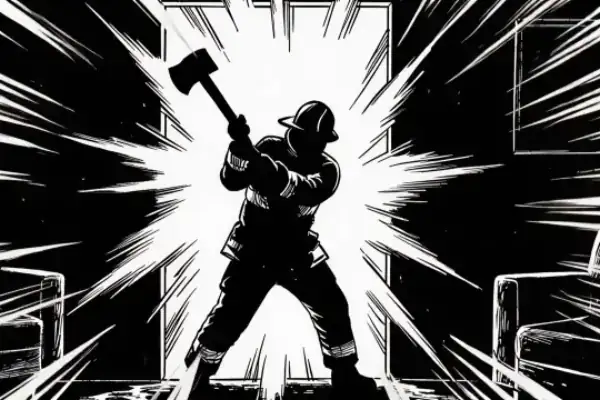
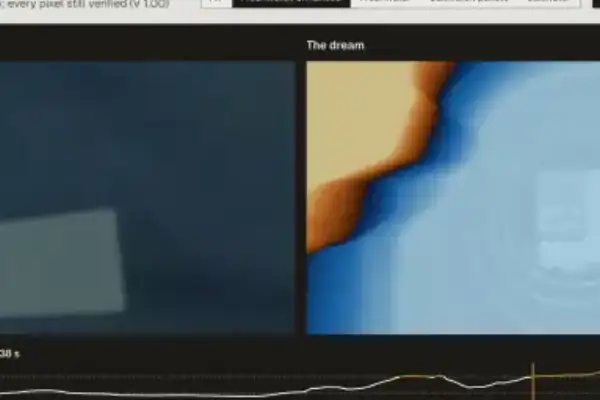
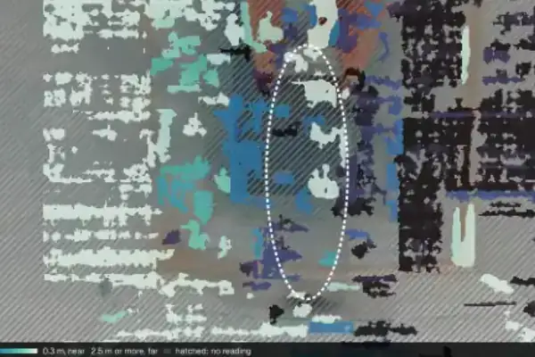
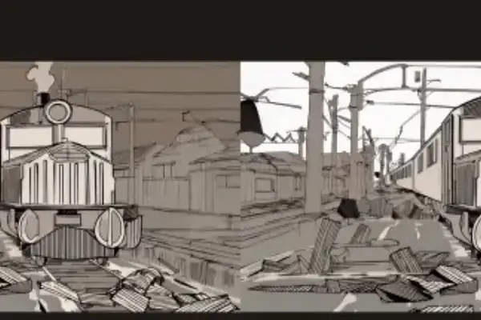
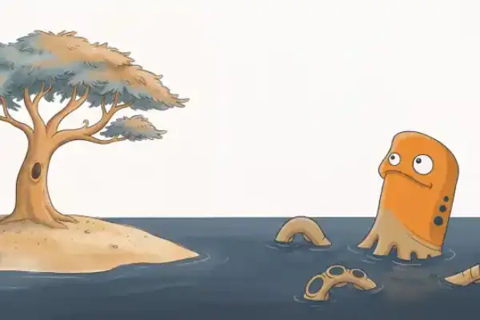
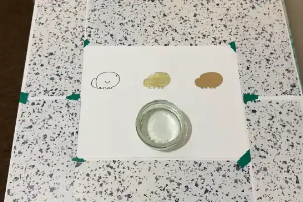
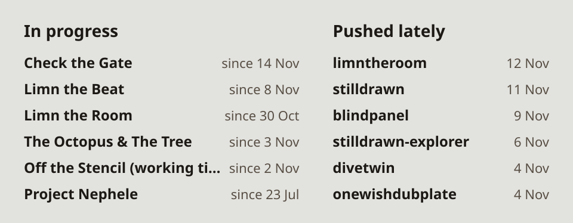
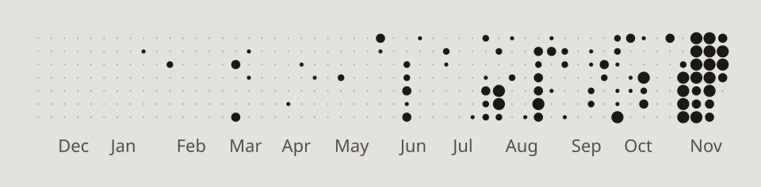

<!-- Built by tools/build.py from templates/README.md every morning. Edit the template, not this file. -->

<a href="https://studionephele.com">
<picture>
<source media="(max-width: 600px) and (prefers-color-scheme: dark)" srcset="assets/masthead-narrow-dark.svg">
<source media="(max-width: 600px)" srcset="assets/masthead-narrow-light.svg">
<source media="(prefers-color-scheme: dark)" srcset="assets/masthead-wide-dark.svg">

</picture>
</a>

I'm Aaron Smiles, a creative technologist and researcher with an EngD in computer vision. Studio Nephele is my studio: I prototype with generative video, 3D and sound, and I measure what the models keep and lose.

Much of the work circles one question: what does a generative model do to a drawing over time, measured honestly?

[Research](https://studionephele.com/research) · [Work with the studio](https://studionephele.com/work-with-the-studio) · [studionephele.com](https://studionephele.com)

✎ New to this? Read it in plain words

Some new computer tools can turn a drawing into a moving video. They don't copy it exactly: the lines start to wander, a bit like tracing paper slipping. I build small things you can try that show this. And I measure how far the lines move. Look at the pictures up top: the drawing, then what a tool made of it. I put my tests and numbers online, so anyone can check my sums.

### Selected work

<ul>
<li><a href="https://studionephele.com/work/stilldrawn"><strong>StillDrawn</strong></a>: Does ink survive image-to-video?</li>
<li><a href="https://studionephele.com/work/dive-twin"><strong>Dive Twin</strong></a>: Does a dreamed tank keep the real tank&#39;s shape? Scrub a dive against it. Made with Runway Gen-4.5.</li>
<li><a href="https://studionephele.com/work/feel-the-depth"><strong>Feel the Depth</strong></a>: Find the bottle by ear: depth from real stereo frames, played as sound.</li>
<li><a href="https://studionephele.com/work/onewishdubplate"><strong>One Wish Dubplate</strong></a>: Every wish granted in one ink drawing, and every wish paid for. Made with Runway Gen-4.5.</li>
<li><a href="https://studionephele.com/work/octopusandthetree"><strong>The Octopus &amp; The Tree</strong></a>: My own verse love story, made into a picture-book film and a book. Made with Nano Banana 2.1.</li>
<li><a href="https://studionephele.com/work/limntheroom"><strong>Limn the Room</strong></a>: What a regenerated video kept of the room, and what it limned.</li>
</ul>

### On the desk

<a href="https://studionephele.com/#work">
<picture>
<source media="(max-width: 600px) and (prefers-color-scheme: dark)" srcset="assets/desk-narrow-dark.svg">
<source media="(max-width: 600px)" srcset="assets/desk-narrow-light.svg">
<source media="(prefers-color-scheme: dark)" srcset="assets/desk-wide-dark.svg">

</picture>
</a>

Redrawn 15 Nov 2026 from the studio's Work list and GitHub.

### Research and data

- **StillDrawn**: a benchmark for the stability of inked line art under image-to-video generation. [Dataset](https://doi.org/10.5281/zenodo.23072784) (CC BY 4.0) · [Paper](https://doi.org/10.5281/zenodo.23965026) · [Code](https://github.com/aaronlsmiles/stilldrawn) · [Explorer](https://stilldrawn.studionephele.com/)
- **UW-TransStereo**: an underwater stereo dataset for detecting and ranging transparent objects. [Dataset](https://doi.org/10.5281/zenodo.16753747) · [Descriptor, IEEE Data Descriptions](https://doi.org/10.1109/IEEEDATA.2026.3721416) · [Code](https://github.com/aaronlsmiles/UW-TransStereo)
- **blindpanel**: blinded human rating of generated video, as a kit. [Code](https://github.com/aaronlsmiles/blindpanel)
- **EngD thesis**: Exploring Stereo-Vision-based Object Detection and Ranging in Underwater Environments, Queen Mary University of London. [Full text](https://qmro.qmul.ac.uk/handle/123456789/131295)

Everything else: [studionephele.com/research](https://studionephele.com/research)

### The year in ink

<picture>
<source media="(max-width: 600px) and (prefers-color-scheme: dark)" srcset="assets/plate-narrow-dark.svg">
<source media="(max-width: 600px)" srcset="assets/plate-narrow-light.svg">
<source media="(prefers-color-scheme: dark)" srcset="assets/plate-wide-dark.svg">

</picture>

1,817 contributions in the last year, 1,294 of them in private repos. One dot a day; the bigger the dot, the busier the day.

Credits, and how this page is made

This page redraws itself every morning. A GitHub Action reads the studio's Work list and GitHub's own record, then inks the panels; nothing in them is typed by hand. The code is in this repo (MIT), and it's set in Geist (SIL OFL 1.1).

Pictures: the masthead and the StillDrawn frame come from StillDrawn (CC BY 4.0, doi:10.5281/zenodo.23072784), and the masthead's moving frames were made with Runway Gen-4.5. The Dive Twin and Feel the Depth frames build on UW-TransStereo (CC BY 4.0, doi:10.5281/zenodo.16753747). Frames marked "made with" a model are generated and not CC BY. Each picture's project is on studionephele.com.

